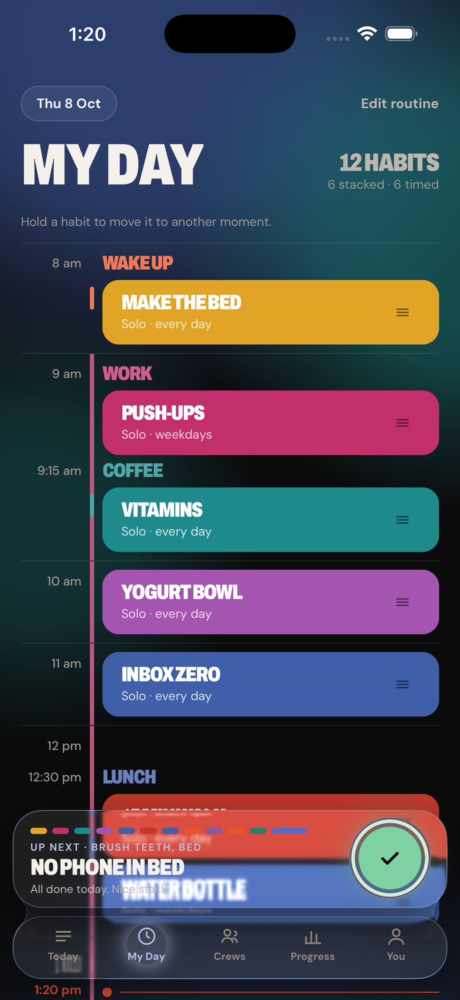
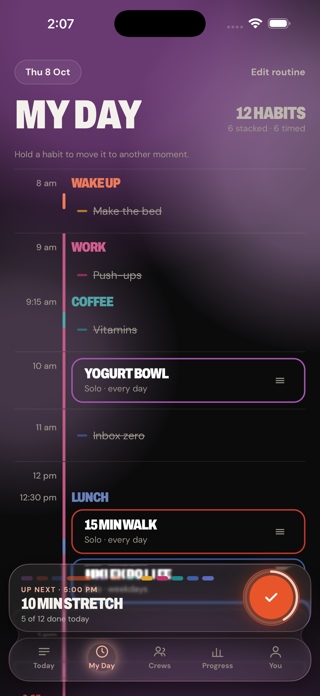
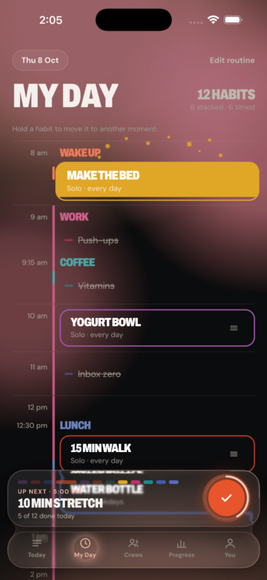

# Changelog

What changed, what it looked like before, and what it looks like now.

Kept for two reasons. The practical one: a screenshot taken a second too late
cannot tell you whether an animation works, and three rounds of a splash got
built here without anyone noticing it was invisible. The other one: this is the
record of how the thing got made, and the good bits of it are worth posting.

Stills and clips live in [demos/](demos/). The whole-app board, regenerated in
one command, is [screenshots/](screenshots/).

To capture more:

```sh
scripts/record.sh check-in /my-day    # a clip you can post
scripts/shots.sh                      # every screen, as a board
```

---

## 8 October 2026

### A done habit gets out of the way — `9f2e38e`

My Day used to fill a habit's card with its colour when you checked it off. The
encoding was backwards: a finished day became the loudest thing on the screen,
twelve solid cards with nothing left to do, and no way to see that without
reading all twelve. This timeline is for what is still coming.

A done habit now shrinks to a struck-through line with a stub of its colour and
gives its room back.

| Before | After |
|---|---|
|  |  |
| Twelve done, twelve loud cards | Twelve done, and you can tell at a glance |

Costs the edit handle on a done habit. Editing is still a tap away on Today and
on Progress, and comes back if you undo.

### Checking off feels like water — `4435cc7`, `54f47e1`

The fold alone was efficient and felt like nothing — card to line in one frame,
so the thing you just did vanished rather than registering. The fill was never
wrong; it was wrong as a *resting* state. As a moment it is exactly right.

The habit's colour now floods up from the bottom of the card, two sheets
drifting sideways at different speeds so the surface reads as liquid rather than
as a rectangle with a decorated edge. It overshoots the brim, sloshes, throws
nine droplets off the top, and folds to its line with the strike drawing across.
About two thirds of a second. Undo gets none of it — taking something back is a
correction, not an achievement.



Clip: [2026-10-08-check-in-water.mp4](demos/2026-10-08-check-in-water.mp4)

The droplets took three attempts and were invisible in all of them. They were
painted under the card, they faded out a twelfth of the way into the flight
— brightest while still inside the card, in exactly the card's colour — and they
launched from its centre rather than its brim. Found by stepping through a
screen recording frame by frame. A still screenshot had said "working" twice.

### Always a way back — `73cc26c`

A screen opened by a deep link or a notification is the first thing in the
stack, so its back control called `router.back()` with nothing to go back to and
silently did nothing. It looked pressable. It was not. Nineteen back buttons now
go through one helper that falls through to Today when there is no history.

Same commit: the habit screen accepts the front of an id, because ids reach it
through a human and a human copying a uuid copies the first eight characters.

### The time zone was never being saved — `d4a89be`

Every profile in the database said `UTC`, including people who have never been
near it. The line meant to keep it in step with the device built a request and
threw it away — a Supabase query builder sends nothing until something awaits
it, and `void supabase.from(...)` awaits nothing. It had been doing that since
the schema was written.

Not cosmetic. Quiet hours are read in that zone, so ten at night meant six in
the evening on New York time: the bedtime reminder suppressed, three in the
morning allowed. And the nightly streak job decides a day has ended in that zone
while the app files check-ins in the device's, so an evening check-in landed on
tomorrow and the day it belonged to was judged empty.

### Seeing your own code — `73cc26c`

The build installed on the simulator is a release build. It carries its
JavaScript inside it and never asks the dev server for anything, so every change
made that afternoon was invisible there and a bug that had already been fixed
went on being reported. `scripts/reload.sh` builds the JavaScript and drops it
into the installed app in about a minute, until a development build is set up.
