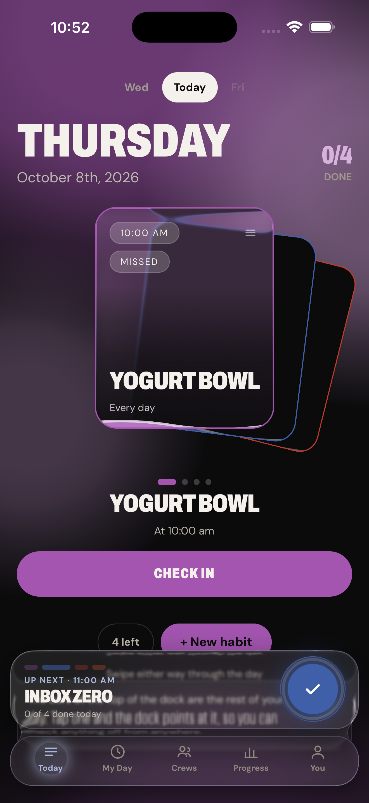
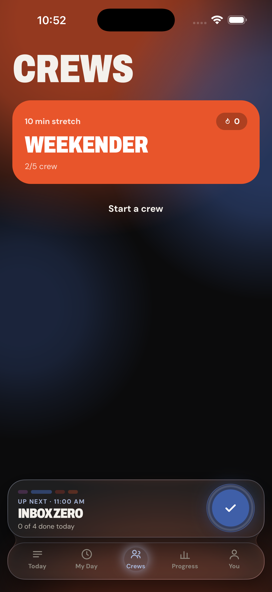
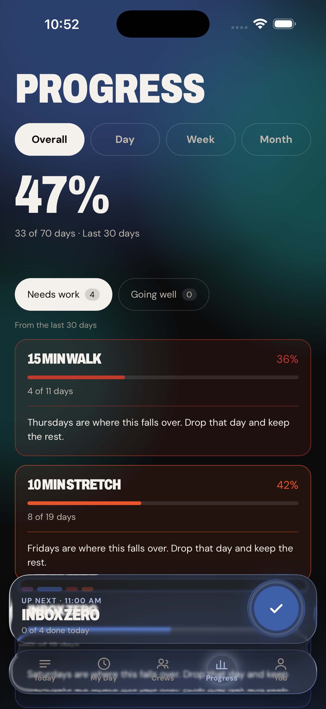
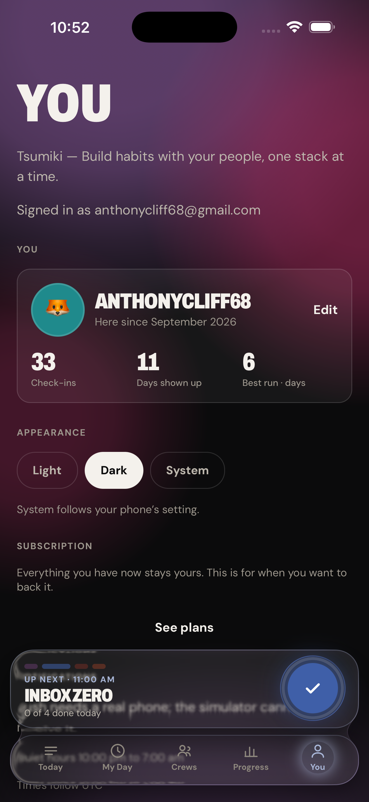
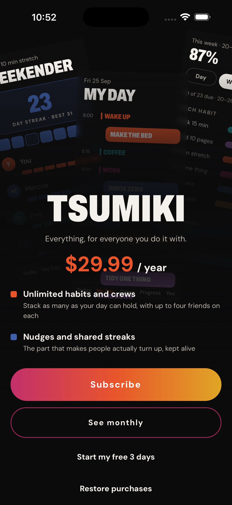
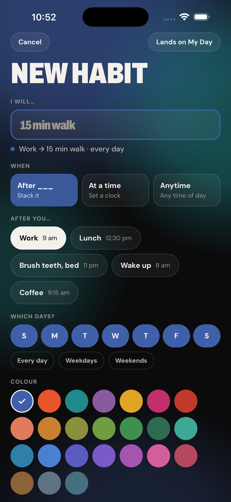
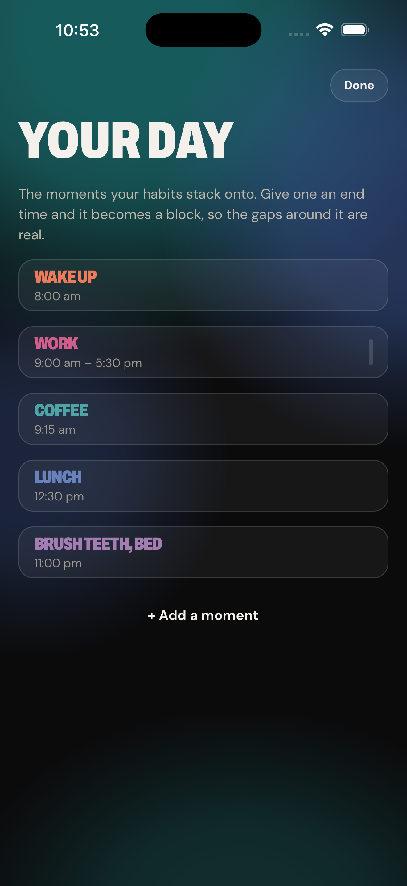

# Screenshot board

Regenerated by `scripts/shots.sh`. Do not edit by hand.

| | Screen | What it is |
|---|---|---|
|  | **today** | Today — the day as a hand of cards |
|  | **my-day** | My Day — the same habits on an hour grid |
|  | **crews** | Crews — every crew and its shared streak |
|  | **progress** | Progress — opens on Overall |
|  | **you** | You — profile, subscription, notifications |
|  | **plans** | Plans — the paywall, opened on purpose |
|  | **new-habit** | New habit — name, when, days, colour, solo or crew |
|  | **schedule** | Schedule — the moments of your day |

---

Taken: 8 October 2026, 10:53 EDT
Commit: `7983087`

Screens needing state that this script cannot create — a crew, an
expired trial, a nudge — are listed in [screens.md](../screens.md)
under **Needs**, and are still captured by hand.
